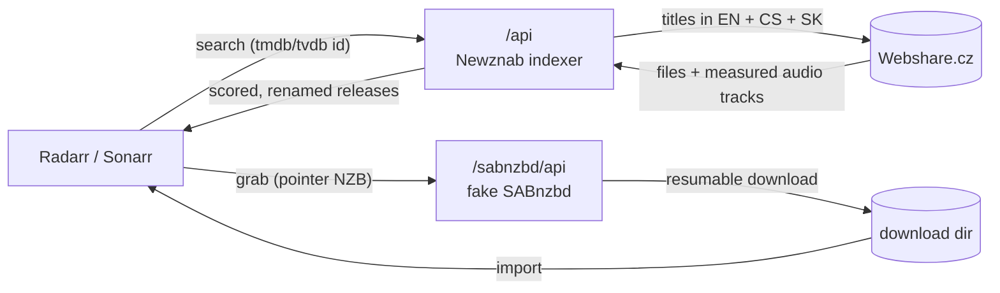

<div align="center">

# 🎬 webshare-arr

**Webshare.cz as a first-class indexer *and* download client for Radarr & Sonarr.**

Czech & Slovak movies and series - dubbed, multi-audio or original - found, scored and imported
like any other release.


</div>

---

Torrent trackers carry little Czech and Slovak content. [Webshare.cz](https://webshare.cz) has a lot of it, but only as
a file host with free-text search and creatively named files: `Počátek (2010).mkv`, `Matrix 1 CZ 1999.mkv`,
`Básníci 6 Jak básníci čekají na zázrak (2016) UP UHD cz.mkv`.

**webshare-arr** is a small container that sits between Webshare and your *arr stack. It pretends to be a
**Newznab indexer** and a **SABnzbd download client**. Radarr and Sonarr search, pick, download and import exactly as
they do with usenet, with no plugins, scripts or manual steps.



## ✨ Features

| | |
|---|---|
| 🔎 **Finds it in any language** | Searches by TMDB/IMDb/TVDB id under the English, original, **Czech and Slovak** titles (from Radarr's metadata server and TMDB), plus hand-made aliases. |
| 🎧 **Knows what's really inside** | Asks Webshare for the *measured* audio tracks and video size of each hit. `Matrix.1999.CZ.2160p.mkv` is published as **TrueHD 7.1, CZ + ENGLISH (multi)**; `Počátek 2010.mkv` as **CZ dub only**. |
| 🏷️ **Releases that parse** | Each hit gets a clean title: *arr's own title, year/SxxEyy, real resolution, source, audio format, languages. Translated or junk-prefixed names import automatically. |
| 📊 **Scores results 0-100** | Title coverage, year, extra words, container, sensible size, votes; cams, trailers and samples are dropped. |
| 📺 **Careful with episodes** | Episode numbers are taken from `S01E02`/`1x02`, or guessed only when the show's episode list confirms it. |
| ⬇️ **Real download client** | Resumable downloads, speed cap, Radarr/Sonarr see progress, queue and history like SABnzbd. |
| 🛡️ **Polite to Webshare** | One global rate limiter, a 30 min search cache, a permanent file-info cache, and files Webshare refuses are hidden for a week (no re-grab loops). |
| 👑 **VIP-aware** | While your account has VIP, Webshare is preferred over torrents. When VIP ends, torrents win again. Fully automatic. |

## 🚀 Quick start

A prebuilt image (amd64 + arm64) is published to `ghcr.io/d56wr/webshare-arr`. Nothing to clone or build.

The example assumes the popular single-share layout, with the same `/srv/data` mounted as `/data` in Radarr and Sonarr:

```
/srv/data
├── torrents/
├── usenet/
│   └── webshare/      <- webshare-arr downloads here
└── media/
    ├── movies/        Radarr root folder
    └── tv/            Sonarr root folder
```

Save this as `docker-compose.yml` (also in the repo as [`docker-compose.example.yml`](docker-compose.example.yml)):

```yaml
services:
  webshare-arr:
    image: ghcr.io/d56wr/webshare-arr:latest
    container_name: webshare-arr
    restart: unless-stopped
    user: "1000:1000"                       # same PUID/PGID as Radarr/Sonarr, so they can move finished files
    ports:
      - "9710:9710"
    environment:
      - WS_USER=your-webshare-username
      - WS_PASS=your-webshare-password
      - API_KEY=pick-any-random-string      # you'll paste it into Radarr/Sonarr
      - DOWNLOAD_DIR=/data/usenet/webshare
      - DATA_DIR=/config
    volumes:
      - ./config:/config                    # caches, aliases.json
      - /srv/data:/data                     # same mount as in Radarr/Sonarr
```

```bash
docker compose up -d
curl localhost:9710/health    # {"ok": true, "jobs": 0, "vip": true}
```

> [!TIP]
> Prefer secrets out of the compose file? Put them in a `.env` next to it (see [`.env.example`](.env.example)) and
> use `env_file: .env` instead. To build it yourself: clone the repo, copy `docker-compose.example.yml` to `docker-compose.yml`,
> add `build: .` and run `docker compose up -d --build`.

### Connect Radarr and Sonarr

1. **Settings → Indexers → + → Newznab (custom)**
   URL `http://<host>:9710`, API path `/api`, API key = `API_KEY`. Categories: movies `2000`, TV `5000`.
2. **Settings → Download Clients → + → SABnzbd**
   Host `<host>`, port `9710`, URL base `/sabnzbd`, API key = `API_KEY`.
3. Done. Search a Czech film and look for the `Webshare` indexer in interactive search.

> [!TIP]
> Webshare is the only "usenet" source, so the **delay profile's preferred protocol** decides ties between Webshare and
> torrents. Let webshare-arr manage it (see [VIP-aware preference](#-vip-aware-preference)).

## 🗣️ Language-aware profiles

The service only reports the facts. Your quality profile decides what to accept. Radarr/Sonarr parse the language tokens
in the release title (`CZ`, `SK`, `ENGLISH`, `FRENCH`, …), so ordinary *Language* custom formats work:

| Custom format | Specs | Suggested score |
|---|---|---|
| Multi: original + CZ | Language **Original** (required) + Language **Czech** (required) | `+1000` |
| Multi: original + SK | Language **Original** (required) + Language **Slovak** (required) | `+1000` |
| Original language | Language **Original** (required) | `+100` |
| Dub without original | Language **Czech** (required) + **not** Original (required) | `-10000`¹ |

¹ Use this in an "original or multi" profile. For a "Czech please" profile, give CZ/SK a positive score instead.

Audio custom formats (TrueHD, DTS-HD MA, DD+, Atmos, …) work too. The audio token in the title comes from the
**original-language track**, so a fancy dub cannot win the audio score.

> [!NOTE]
> Radarr/Sonarr compare **quality first, custom-format score second**. A multi-audio 1080p file will not replace your
> 2160p original. That is usually what you want.

## ⚙️ Configuration

| Variable | Default | |
|---|---|---|
| `WS_USER`, `WS_PASS` | - | Webshare login (**required**) |
| `API_KEY` | - | Shared secret for Radarr/Sonarr (**required**) |
| `PORT` | `9710` | HTTP port |
| `DOWNLOAD_DIR` | `/downloads` | Finished files; partial ones live in `.incomplete/`. Must be the same path inside Radarr/Sonarr |
| `DATA_DIR` | `/data` | Caches and state (see below) |
| `MAX_MBPS` | `0` | Download speed cap in MB/s, `0` = unlimited |
| `MIN_SCORE` | `55` | Minimum match score 0-100 |
| `MIN_MB` / `MAX_GB` | `150` / `40` | File size window |
| `WS_MIN_INTERVAL` | `0.25` | Seconds between Webshare API calls |
| `FILEINFO_MAX` | `60` | Hits per search whose audio tracks are looked up |
| `UNAVAILABLE_DAYS` | `7` | How long a file Webshare refused stays hidden |
| `TMDB_TOKEN` | - | TMDB *API Read Access Token*: Czech/Slovak **series** titles |
| `RADARR_URL` / `RADARR_KEY` | - | Enables VIP-aware preference for Radarr |
| `SONARR_URL` / `SONARR_KEY` | - | …and for Sonarr |
| `VIP_CHECK_MINUTES` | `60` | How often the VIP status is checked |

### Files in `DATA_DIR`

| File | |
|---|---|
| `aliases.json` | Your extra titles (hand-edited, reloaded automatically) |
| `fileinfo.json` | Measured audio/video info per Webshare file (cache, safe to delete) |
| `unavailable.json` | Files Webshare refused recently (safe to delete) |

## 🧩 Extra titles

Movies get Czech/Slovak titles automatically. Series do only with `TMDB_TOKEN`, and some shows are simply known
under a different local name. Add those by hand (TVDB id for series, TMDB id for movies):

```json
{
  "tv":    { "74584": ["Gordon Ramsay Noční můry kuchyně"] },
  "movie": { "60672": ["Purpurové řeky 2"] }
}
```

## 👑 VIP-aware preference

A free Webshare account downloads at roughly 300 KB/s. VIP downloads at full speed. With `RADARR_*` / `SONARR_*` set, the service
checks the account every hour and adjusts both apps:

| | Delay profile prefers | Webshare indexer priority |
|---|---|---|
| **VIP active** | usenet (= Webshare) | `25` |
| **No VIP** | torrent | `40` |

Manual changes to these two settings are overwritten on the next check. Remove the variables to opt out.

## 🔌 Endpoints

| Path | |
|---|---|
| `GET /api?t=caps\|search\|movie\|tvsearch\|get` | Newznab |
| `GET/POST /sabnzbd/api?mode=…` | SABnzbd (`version`, `get_config`, `queue`, `history`, `addfile`, `addurl`, `delete`) |
| `GET /health` | `{"ok", "jobs", "vip"}` |

## ❓ FAQ

<details>
<summary><b>Do I need VIP?</b></summary>

No. Everything works on a free account, just slowly (~300 KB/s). The VIP-aware preference keeps torrents first while you
are on free.
</details>

<details>
<summary><b>Why "usenet"? I don't use usenet.</b></summary>

Radarr and Sonarr only know torrent and usenet clients. A Newznab indexer plus a SABnzbd client is the cleanest way to plug
in a custom source. The "NZB" is only a tiny pointer to a Webshare file.
</details>

<details>
<summary><b>Interactive search shows a Webshare result but "Unknown movie"?</b></summary>

Interactive/free-text searches without an id fall back to the original file name. Searches by id (what Radarr/Sonarr do
automatically, and in interactive search from the movie page) are renamed and parse reliably.
</details>

<details>
<summary><b>Will it hammer Webshare during a big "search all missing"?</b></summary>

No. Every API call waits for a shared limiter, searches are cached for 30 minutes and file info forever. Tools like
Huntarr/Newtarr are fine.
</details>

## ⚖️ License & disclaimer

[MIT](LICENSE).

This is an unofficial project, not affiliated with Webshare.cz. You need your own Webshare account. You are responsible
for complying with Webshare's terms and the copyright law of your country.

<div align="center"><sub>Built for a homelab with too few Czech dubs. 🇨🇿 🇸🇰</sub></div>
